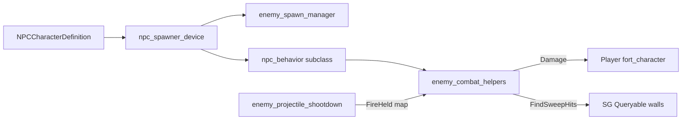

# Spawning, SG walls, dungeon, lane test

Sources: `enemy_spawn_manager.verse`, `sg_collision_helpers.verse`, `dungeon_level_spawner.verse`, `npc_lane_test_switch.verse`.

## Wave spawn manager — exact

Wire **every** Character Spawner into `NPCSpawner1..11`. Wire sploder into `SploderSpawner`. Seed wave + each interval spawn **all** wired types.

| Field | Default |
|-------|---------|
| SpawnInterval | 8.0 |
| MaxAlive | 40 |
| DetectionRange | 6000.0 |
| SeedWaveOnStart | true |
| AutoSpawn | true |

```verse
enemy_spawn_manager<public> := class(creative_device):
    @editable NPCSpawner1:?npc_spawner_device = false
    # … NPCSpawner2..11 …
    @editable SploderSpawner:?npc_spawner_device = false
    @editable SpawnInterval:float = 8.0
    @editable MaxAlive:int = 40
    @editable DetectionRange:float = 6000.0
    @editable SeedWaveOnStart:logic = true
    @editable AutoSpawn:logic = true
    var AliveCount<private>:int = 0

    OnBegin<override>()<suspends>:void =
        # For each wired spawner:
        #   S.SpawnedEvent.Subscribe(OnSpawned)
        #   S.EliminatedEvent.Subscribe(OnEliminated)
        if (SeedWaveOnStart?):
            SpawnAllTypes()
        if (AutoSpawn?):
            SpawnLoop()

    SpawnLoop()<suspends>:void =
        loop:
            Sleep(SpawnInterval)
            if (AliveCount < MaxAlive):
                SpawnAllTypes()

    SpawnAllTypes():void =
        # TrySpawn each NPCSpawner1..11 + SploderSpawner

    TrySpawn(MaybeSpawner:?npc_spawner_device):void =
        if (AliveCount < MaxAlive, S := MaybeSpawner?):
            S.Spawn()

    OnSpawned(Agent:agent):void =
        set AliveCount += 1

    OnEliminated(Result:device_ai_interaction_result):void =
        set AliveCount = Max(0, AliveCount - 1)
```

### Spawner checklist

1. One `npc_spawner_device` per `NPCDef_*` (see `roster`).
2. Assign definition on each spawner.
3. Place `enemy_spawn_manager` → wire refs in Details.
4. Label/folder: `Hub/Spawners/...`.
5. Optional: `npc_lane_test_switch` for per-lane Enable+Reset+Spawn testing.

---

## SG collision helpers (arrows need these)

`FindSweepHits` only sees Queryable SG meshes — not StaticMeshActors / SpawnProp.

```verse
using { /Fortnite.com/Devices }
using { /UnrealEngine.com/BasicShapes }
using { /UnrealEngine.com/Temporary/SpatialMath }
using { /Verse.org/SceneGraph }
using { /Verse.org/Simulation }

# Spawns a collidable, queryable box. SizeCm = full edge lengths in cm (X/Y/Z).
SGSpawnBlockBox<public>(Sim : entity, Position : vector3, SizeCm : vector3, ?Visible : logic = false) : entity =
    ScaleVec := vector3{X := Max(SizeCm.X / 100.0, 0.05), Y := Max(SizeCm.Y / 100.0, 0.05), Z := Max(SizeCm.Z / 100.0, 0.05)}
    Block := entity{}
    Mesh := cube{Entity := Block}
    set Mesh.Collidable = true
    set Mesh.Queryable = true
    set Mesh.Visible = Visible
    Block.AddComponents(array{Mesh})
    # AddEntities first, then SetGlobalTransform: a pose set before adding is overwritten.
    Sim.AddEntities(array{Block})
    Block.SetGlobalTransform(FromTransform(transform{Translation := Position, Rotation := IdentityRotation(), Scale := ScaleVec}))
    Block

# Uniform cube. The option is `?Show`, not `?Visible`: forwarding `?Visible := Visible`
# collides with this function's own parameter and is rejected as ambiguous.
SGSpawnBlockCube<public>(Sim : entity, Position : vector3, EdgeCm : float, ?Show : logic = false) : entity =
    SGSpawnBlockBox(Sim, Position, vector3{X := EdgeCm, Y := EdgeCm, Z := EdgeCm}, ?Visible := Show)

SGRemoveEntity<public>(Ent:entity):void =
    Ent.RemoveFromParent()
```

### Devices

| Device | Role |
|--------|------|
| `sg_blocker_cube` | Place on cover; EdgeCm=256 default; spawns Queryable cube at device transform |
| `sg_hub_collision_baker` | Bakes invisible SG boxes for hub StaticMeshActors (floor, pillars, portal, shops) — hardcoded half-extents from Roguelike hub |
| `sg_npc_test_lane_walls` | LaneCount=11, LaneWidth=400, LaneDepth=1000 — divider + back walls for cross-lane shot tests |

---

## Lane test switch

All wired spawners start **disabled**. Lane trigger N → Enable + Reset + Spawn that one. Toggle button / EnableAll / DisableAll for mass control.

```verse
npc_lane_test_switch<public> := class(creative_device):
    @editable NPCSpawner1 : ?npc_spawner_device = false
    # … NPCSpawner2 to NPCSpawner11 the same way
    @editable LaneTrigger1 : ?trigger_device = false
    # … LaneTrigger2 to LaneTrigger11 the same way
    @editable ToggleButton : ?button_device = false
    @editable EnableAllTrigger : ?trigger_device = false
    @editable DisableAllTrigger : ?trigger_device = false

    ActivateSpawner(MaybeSpawner : ?npc_spawner_device) : void =
        if (Spawner := MaybeSpawner?):
            Spawner.Enable()
            Spawner.Reset()
            Spawner.Spawn()
        else:
            Print("[LaneTest] lane spawner not wired")
```

Also set spawners **DisabledAtGameStart** in Creative Details.

---

## Dungeon level spawner (optional runtime rooms)

`dungeon_level_spawner` builds floors from **SG cubes** (Visible + Collidable + Queryable) so players walk on them **and** archer `FindSweepHits` blocks. Optional SpawnProp visuals (`AlsoSpawnPropVisuals`).

| Field | Default |
|-------|---------|
| TileSize | 256 |
| WallHeightTiles | 2 |
| MinRoomTiles / MaxRoomTiles | 7 / 12 |
| EnemySpawnPoints | 6 |
| MaxBlocksPerFloor | 700 |
| StartingFloor | 1 |
| AutoGenerateOnBegin | false |
| UseHubExitEnterEvent | true |
| UsePortalProximity | true |
| PortalEnterRadius | 400 |

Wired concrete devices (not optional): `EnterTrigger`, `StartButton`, `HubExitTeleporter`, `DungeonSpawnTeleporter`.

Flow:

1. Portal / button / trigger / proximity → `StartRunForAgent`
2. `GenerateFloor` → clear old blocks → floor tiles → perimeter walls with south door gap → pillars → enemy spawn points
3. Move `DungeonSpawnTeleporter` to player spawn → Teleport + `TeleportAgentUntilSuccess` (40 tries)
4. Increment FloorNumber

Returns `dungeon_floor_result{ PlayerSpawn, EnemySpawns, DoorWorldPos }`.

**Do not** use StaticMeshActor blueprints for runtime spawn — Verse cannot spawn those. SG tiles are the collision + blockout source.

---

## Full system wiring diagram



## New-island minimum

1. `enemy_ai_helpers` + `enemy_combat_helpers` + at least one behavior.
2. `enemy_projectile_shootdown` if any ranged.
3. SG walls (baker / blocker / dungeon tiles).
4. One spawner + `enemy_spawn_manager` (or lane switch for tests).
5. NPCDef → behavior class → AttackAnim filled.
